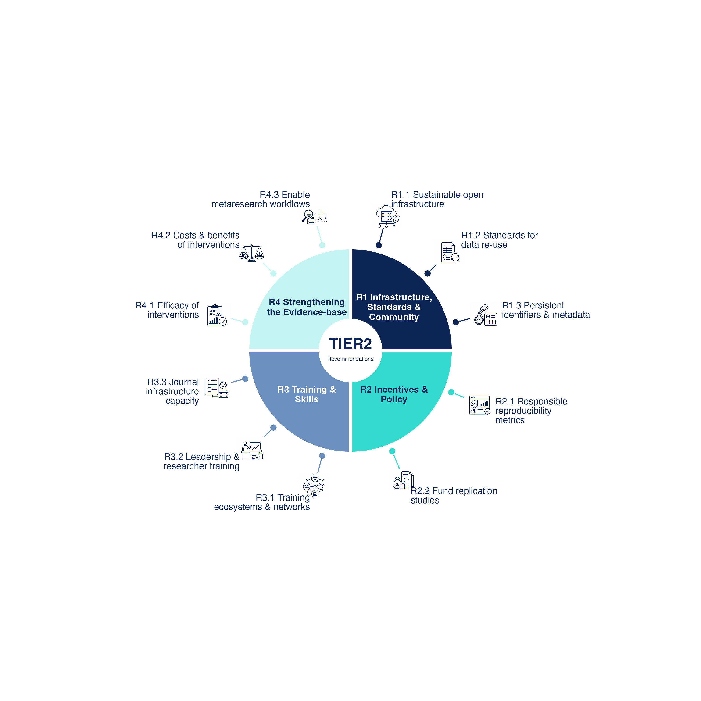

# TIER2 recommendations

Visualisations of the recommendations for reproducible research in
"Making research more reproducible: eleven paths forward", developed in the
TIER2 project. The repository contains publication-ready static figures and a
self-contained interactive webpage showing how the recommendations relate to
stakeholder groups and thematic categories.



## Outputs

### Publication figures

[`01_publication_static/circle_diagram.R`](01_publication_static/circle_diagram.R)
generates two figure layouts in PDF and 300 dpi PNG formats:

- a circular overview with stakeholder-specific panels;
- a spoke diagram with one icon and label per recommendation.

Generated files are stored in [`01_publication_static/output/`](01_publication_static/output/).

### Interactive visualisations

[`02_interactive_plots/TIER2_stakeholder_matrix.qmd`](02_interactive_plots/TIER2_stakeholder_matrix.qmd)
renders a self-contained HTML page containing:

- an interactive spoke diagram with click-to-view recommendation details;
- a filterable stakeholder responsibility matrix, showing the illustrative
  actions of Table S1 per stakeholder;
- a stakeholder–recommendation network;
- the paper's references cited in the recommendation texts, with the paper's
  numbering, under each recommendation and at the end of the page.

The rendered page is available locally at
[`02_interactive_plots/TIER2_stakeholder_matrix.html`](02_interactive_plots/TIER2_stakeholder_matrix.html)
and is configured for publication at
[Uni-graz.at](https://cs2.uni-graz.at/reproducibility-recommendations/).

## Repository structure

```text
.
├── 01_publication_static/
│   ├── circle_diagram.R             # Static figure generation
│   ├── TIER2_recommendations.xlsx   # Recommendation data
│   ├── icons/                       # Recommendation icons
│   └── output/                      # Generated PDF and PNG figures
├── 02_interactive_plots/
│   ├── TIER2_stakeholder_matrix.qmd # Interactive Quarto source
│   ├── TIER2_recommendations.xlsx   # Recommendation data
│   ├── TIER2_priority_effort_ratings.csv
│   └── TIER2_stakeholder_matrix.html
├── 03_archive_sandbox/              # Superseded experiments and outputs
└── TIER2_recommendations.Rproj       # RStudio project
```

The two active output folders currently keep separate copies of the
recommendation workbook. When recommendation content changes, update both
copies or explicitly verify that they are still aligned. Files under
`03_archive_sandbox/` are retained for reference and are not part of the
current build workflow.

## Requirements

- R
- Quarto, for the interactive page
- The following R packages:
  - `tidyverse`
  - `ggforce`
  - `patchwork`
  - `stringr`
  - `readxl`
  - `geomtextpath`
  - `ggimage`
  - `visNetwork`
  - `htmlwidgets`
  - `htmltools`
  - `jsonlite`

Install the R dependencies with:

```r
install.packages(c(
  "tidyverse", "ggforce", "patchwork", "stringr", "readxl",
  "geomtextpath", "ggimage", "visNetwork", "htmlwidgets",
  "htmltools", "jsonlite"
))
```

## Reproducing the outputs

Clone the repository and run commands from its root directory. The scripts also
locate their input folders when launched from elsewhere within the repository.

Generate the static figures:

```sh
Rscript 01_publication_static/circle_diagram.R
```

Render the interactive page:

```sh
quarto render 02_interactive_plots/TIER2_stakeholder_matrix.qmd
```

The Quarto output is self-contained and uses embedded JavaScript, so the
resulting HTML file can be opened directly from the local filesystem or
published as a single file without a separate web server.

## Data notes

Both folders keep an identical copy of `TIER2_recommendations.xlsx` with three
sheets:

- `Sheet1`: the eleven recommendations (`No`, `Title`, `Description`,
  `Category`, `Stakeholder`). Titles and texts are those of the revised
  manuscript (October 2026), including its numbered citations; categories
  follow the paper's Table 1; a stakeholder is listed for a recommendation
  when Table S1 of the supplement gives actions for it.
- `Actions`: the illustrative actions of Table S1, one row per action, with
  the table's footnote text in `Note` where it has one.
- `References`: the paper's numbered reference list.

The static figures read only `Sheet1`. The spoke diagrams use shortened
display labels, set in `circle_diagram.R` and in the Quarto file.
`TIER2_priority_effort_ratings.csv` still uses the numbering of the original
12-recommendation set; the Quarto file drops the original `R2.1` and renumbers
`R2.2` → `R2.1` and `R2.3` → `R2.2` when reading it.
